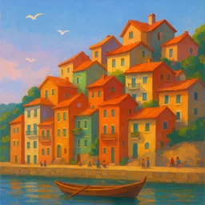

Sample note, replace me.

The hard part of making a game is not starting. It is the last tenth: menus, saving, sound, the bug that only appears on one phone. A small game lets you reach that last tenth while you still care.

## Pick a size

A useful constraint is one sentence: *build a crooked town and watch people live in it*. If the sentence needs an "and also", the game is two games.

Size limits help as well. A jam with a hard byte limit forces every decision to be a trade, which is the same muscle as cutting scope at work.

## Finish, then polish

1. Make the whole loop playable in the ugliest possible form.
2. Play it with someone who owes you nothing. Children are ideal: they stop playing the moment it is boring.[^kids]
3. Fix what made them stop.
4. Only then add juice: easing, particles, a sound for every tap.

## Where the maths hides

Even the smallest game is full of mathematics: easing curves, random numbers that feel fair, rotation without gimbal trouble. The last one has a lovely explanation in [[imaginary-numbers-as-rotation]].

[^kids]: They are also honest in a way adult play testers rarely are.
